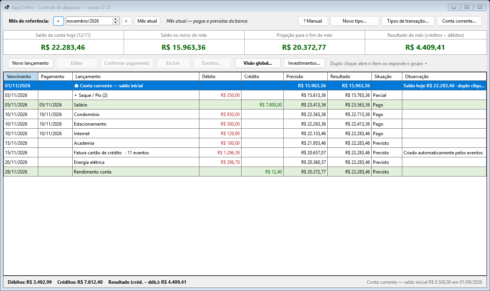
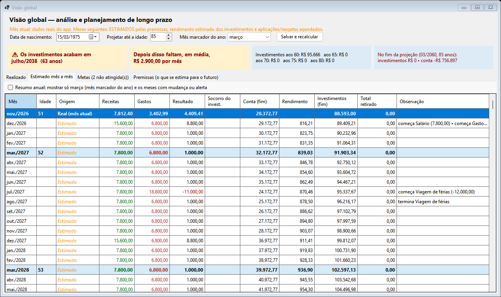
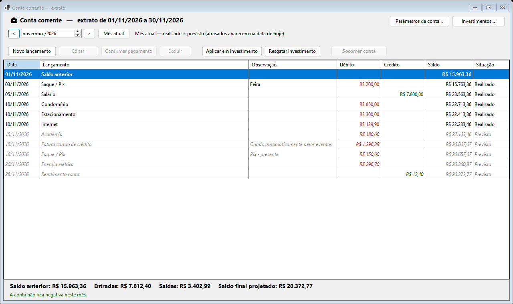

<h1 align="center">AppCtrlFin</h1>

<strong>Controle financeiro pessoal gratuito para Windows</strong> 
Conta corrente · cartões de crédito · investimentos · visão global de longo prazo

  
  

## O que ele faz

- **Mês a mês:** cada lançamento nasce previsto e é confirmado com a data e o valor pagos. Você vê o saldo de hoje e a projeção do fim do mês.
- **Cartões de crédito:** as compras entram pelo dia de corte, e a fatura do mês se monta sozinha, com estornos e parcelas.
- **Conta corrente:** extrato do dia 1º ao último dia do mês, com aviso de quando a conta vai ficar negativa.
- **Investimentos:** aplicações, resgates, rendimentos e projeção. Um investimento pode **socorrer** a conta negativa.
- **Visão global:** sua análise de longo prazo até a idade que escolher, com o realizado, o estimado pelas premissas e as **metas**. Quando uma meta não é atingida, mostra quanto a mais por mês resolveria.

Seus dados ficam **só no seu computador**, num único arquivo, sem conta, sem internet e sem servidor.

## Veja funcionando

🎬 **[Vídeo de apresentação](docs/video/AppCtrlFin-apresentacao.mp4)**: 5 minutos, narrado e com legendas.

| | |
|---|---|
|  |  |
|  |  |

*Todas as telas usam dados fictícios.*

## Instalar

1. Baixe o **[AppCtrlFinApp-win-Setup.exe](https://github.com/marcuslimaarruda/AppCtrlFin/releases/latest/download/AppCtrlFinApp-win-Setup.exe)**.
2. Execute. A instalação é por usuário, não pede administrador e não precisa instalar mais nada.
3. Pronto: o app abre zerado. O **[manual](https://marcuslimaarruda.github.io/AppCtrlFin/manual/)** está no botão **? Manual**.

> **"O Windows protegeu o computador"?** O instalador ainda não tem assinatura digital. Clique em **Mais informações → Executar assim mesmo**.

O app avisa quando houver versão nova e se atualiza sozinho, sem mexer nos seus dados.

## Requisitos

Windows 10 ou 11 (64 bits). Versões para Android e iOS estão nos planos.

---
Uso gratuito, veja os [termos](TERMOS.md). Desenvolvido por **[Marcus Lima Arruda](https://github.com/marcuslimaarruda)**, ACI – Arruda Consultoria em Informática.
Este repositório é uma vitrine com o manual, o vídeo e os instaladores; o código-fonte não é público.
